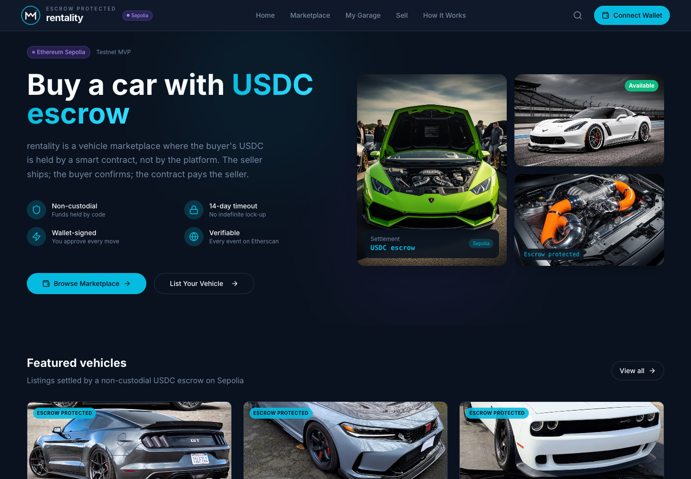
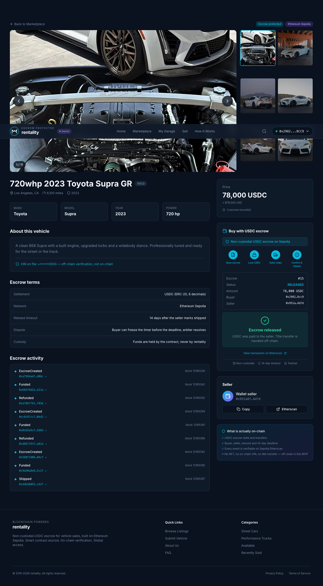

# rentality — Enhanced MVP

A vehicle marketplace with non-custodial USDC escrow on **Ethereum Sepolia**.

**Live app:** https://rentality.heurist.online
**Read-only source viewer:** https://rentality.heurist.online/code

> This repository is a **public project showcase only**. The application source lives in a
> **private** repository and is not published here. The `/code` viewer is a curated, read-only
> view with no git clone or archive download endpoint. Visible code can still be copied manually.

## What it does

- Buyers connect an EIP-1193 wallet, sign in with SIWE, and fund a USDC escrow.
- Sellers register, upload vehicle photos, publish a listing, and mark a funded escrow shipped.
- The contract holds the USDC; the platform never takes custody.
- The buyer confirms delivery to release payment.
- A 14-day timeout releases to the seller if the buyer is silent and does not dispute.
- An arbiter can refund a disputed escrow or release it to the seller.
- Every escrow event is indexed into PostgreSQL and verifiable on Sepolia Etherscan.

## Feature set

| Area | Implemented |
|---|---|
| Auth | SIWE nonce/verify, HMAC session cookie |
| Registration | display name, bio, avatar, buyer/seller/both |
| Listings | create, browse, search, filters, available/sold/all |
| Vehicle data | make, model, year, VIN (masked publicly), mileage, horsepower, location |
| Images | authenticated JPEG/PNG/WebP uploads, multiple per listing, 5 MB max |
| Escrow | create, approve, fund, ship, confirm, dispute, cancel, refund, release, timeout |
| Wallet | MetaMask/injected EIP-1193, Sepolia switch/add + chain guard |
| Faucet | 250,000 test USDC + gas, gas top-ups |
| My Garage | purchases, sales, my vehicles |
| Operator | arbiter-only refund/release/timeout console |
| Assistant | one-question Ask Agent over live listings and app knowledge |
| Viewer | public `/code` read-only source browser |
| Ops | nginx, systemd, TLS, PostgreSQL, backups, health checks |
| Verification | DB 16/16, chain 11/11, API 31/31 checks, run twice |

## Stack

- **Frontend:** React 18, Vite 5, TypeScript, Tailwind 3, shadcn/Radix
- **API:** NestJS 12, Prisma 6, Zod, viem
- **Database:** PostgreSQL 16
- **Contracts:** Solidity 0.8.28, Foundry
- **Chain:** Ethereum Sepolia, chain ID `11155111`
- **Host:** AWS EC2, Ubuntu 24.04, nginx, systemd, certbot

## Contract

| | |
|---|---|
| Escrow | `0x4e8DFBd676AeEB10D57727DdFF2450B175913e0E` |
| Test USDC | `0xBA24365396f6f92BDA5C0087d8806B7C545eb8e3` |
| Arbiter | `0x3fBEb93D2bcD2b5A727CFD9a61348a0EB745f452` |
| Release timeout | 14 days |
| Explorer | https://sepolia.etherscan.io/address/0x4e8DFBd676AeEB10D57727DdFF2450B175913e0E |

## Preview access

The live app currently uses a shared preview gate. Credentials are supplied separately; the gate is
a presentation control, not security.

## Boundaries

- Testnet only. The contract is **not independently audited**.
- No NFT, tokenized title or on-chain VIN verification.
- No WalletConnect, fiat on-ramp, KYC, financing or shipping integration.
- Title/ownership transfer is off-chain.
- Test USDC is a mock token with no real value.

## Documentation

- Public source viewer: https://rentality.heurist.online/code
- The full private repository keeps architecture, deployment, API, database, blockchain, security
  and audit documentation under `documentation/`.

## License

All rights reserved. This repository is documentation-only and does not grant a license to the
rentality source code.
